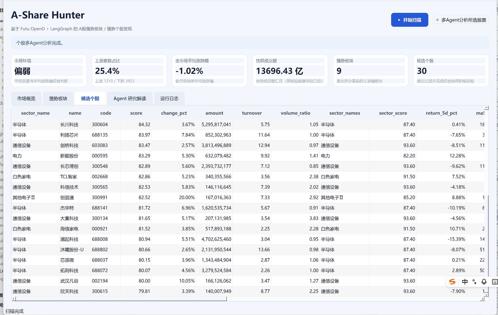
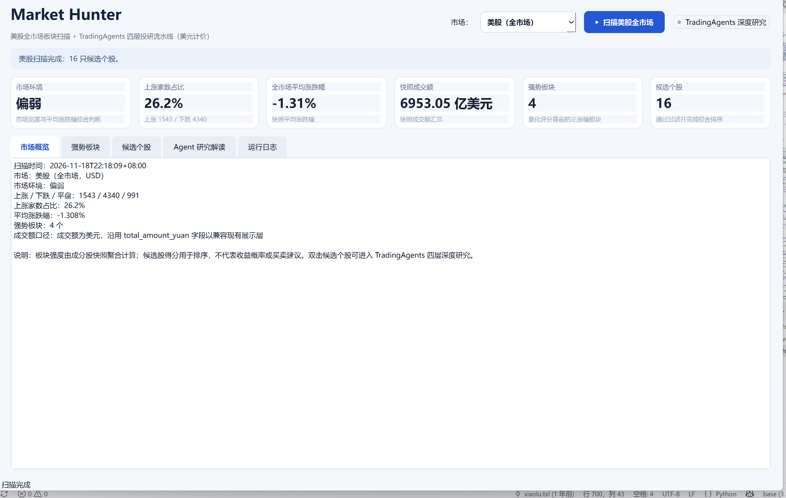
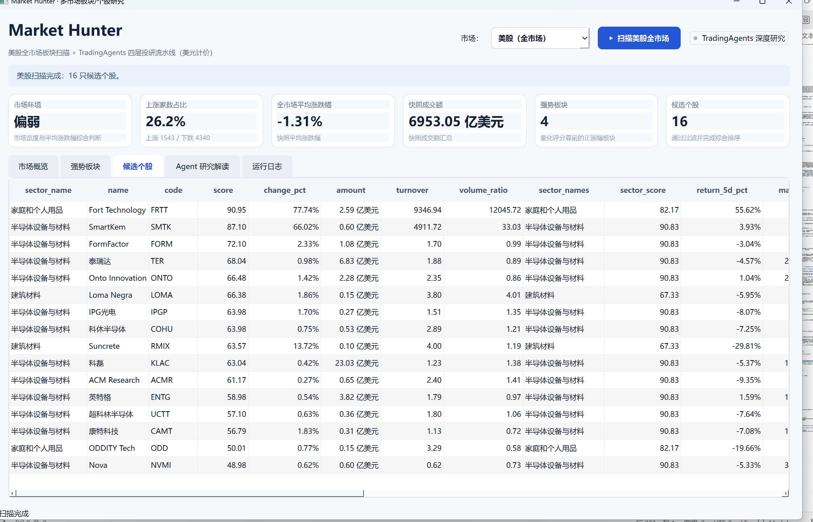
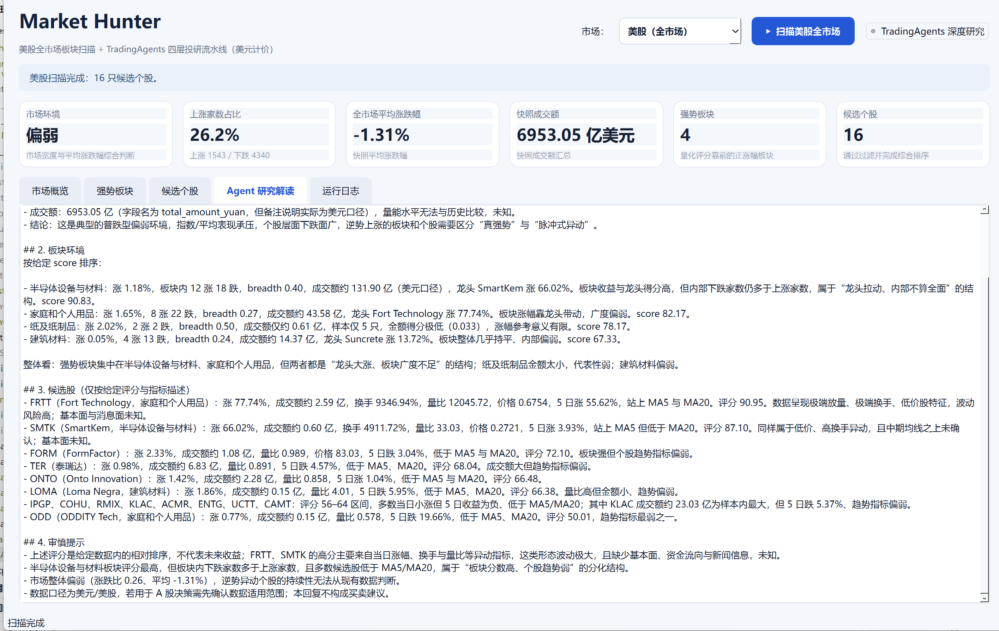
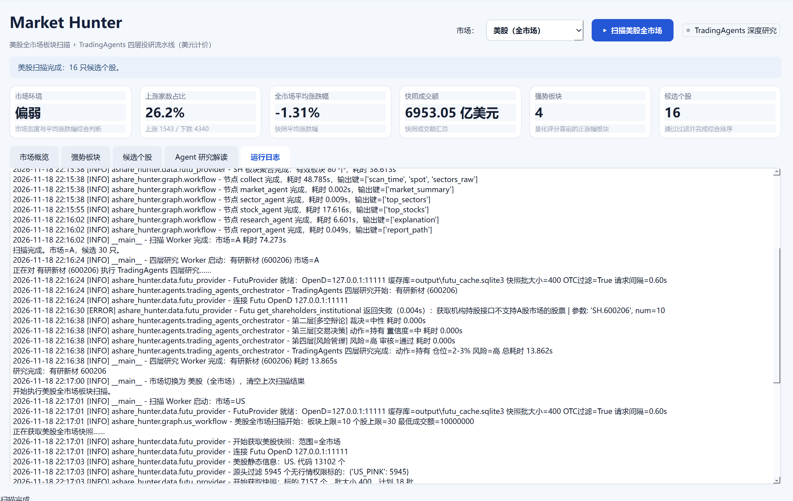
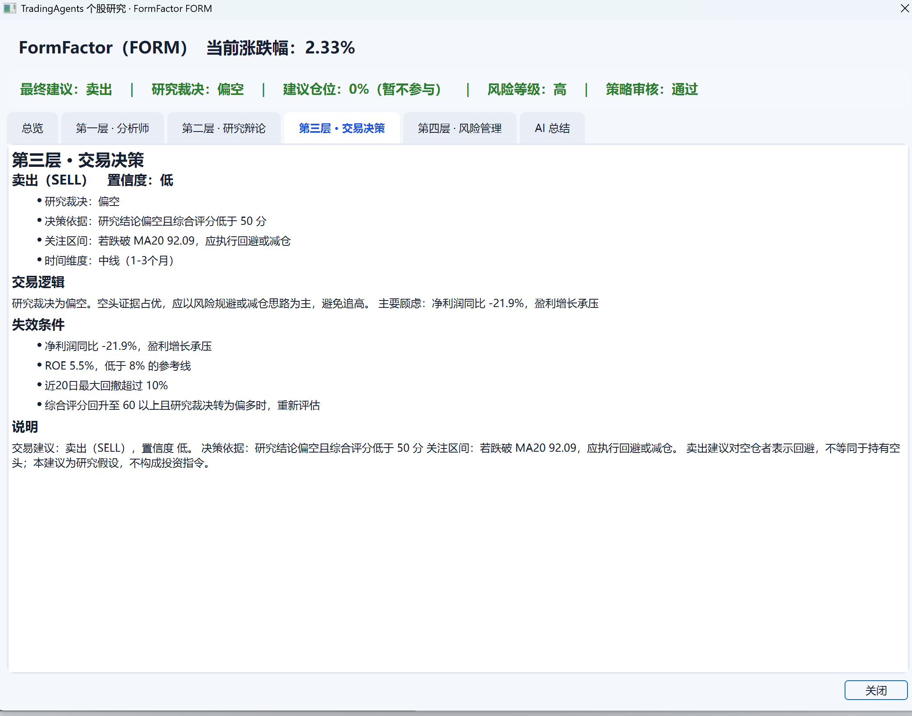
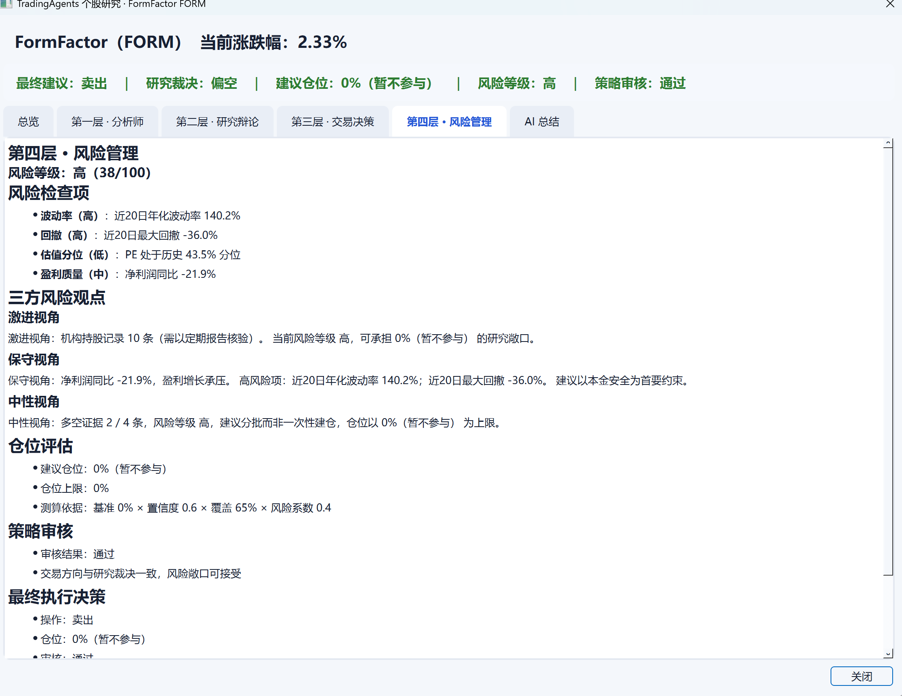
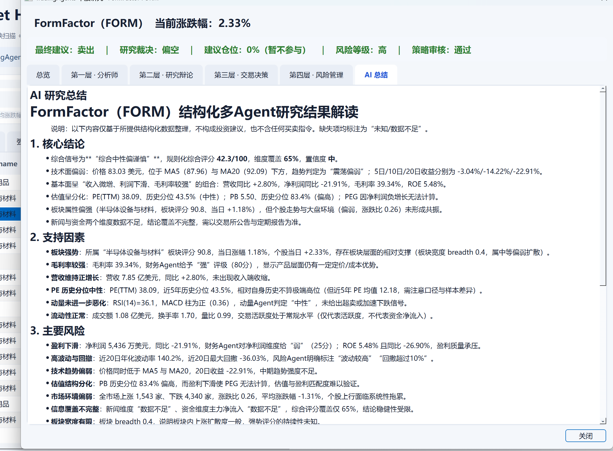

# A-Share Hunter（Futu OpenD 版）

A 股强势板块与强势个股发现 Agent。行情数据通过 **Futu OpenD + futu-api** 获取，Pandas 负责量化打分，LangGraph 编排工作流；DeepSeek 仅用于可选文字解读。

## 一、运行前准备

1. 安装并启动 Futu OpenD。
2. 登录具备 A 股行情权限的 Futu 账号。
3. 确认 OpenD 监听地址和端口，默认 `127.0.0.1:11111`。
4. 安装 Python 依赖并配置环境变量。

```bash
pip install -r requirements.txt
```

Windows：
```powershell
copy .env.example .env
python main.py
```

macOS/Linux：
```bash
cp .env.example .env
python main.py
```

## 二、数据接口映射

| Agent 所需数据 | Futu API |
|---|---|
| A 股静态证券列表 | `get_stock_basicinfo` |
| 全市场行情快照 | `get_market_snapshot` |
| 行业/概念板块列表 | `get_plate_list` |
| 板块成分股 | `get_plate_stock` |
| 个股历史日 K | `request_history_kline` |

官方文档：
- [Futu OpenAPI 介绍](https://openapi.futunn.com/futu-api-doc/intro/intro.html)
- [行情接口总览](https://openapi.futunn.com/futu-api-doc/quote/overview.html)
- [获取市场快照](https://openapi.futunn.com/futu-api-doc/quote/get-market-snapshot.html)
- [获取板块列表](https://openapi.futunn.com/futu-api-doc/quote/get-plate-list.html)
- [获取板块内股票列表](https://openapi.futunn.com/futu-api-doc/quote/get-plate-stock.html)
- [获取历史 K 线](https://openapi.futunn.com/futu-api-doc/quote/request-history-kline.html)

## 三、板块缓存机制

Futu 对板块列表和板块成分股接口有频率限制。本项目将板块成分股缓存到 `output/futu_cache.sqlite3`，默认每次运行最多刷新 10 个板块，缓存 7 天。

首次运行时，部分板块可能尚未进入缓存，因此报告中的板块覆盖率可能不完整。建议在非交易高峰期逐步初始化缓存。若希望一次性刷新所有缺失/过期板块，可在 `.env` 中设置：

```ini
FUTU_MAX_PLATE_REFRESH_PER_RUN=0
```

这可能需要较长时间，不建议在短时间内反复执行。之后可恢复为 10 或更小值。

## 四、数据口径和限制

- 行情快照每批最多 400 个标的；项目自动分批获取。
- 板块强度是根据当前板块成分股的涨跌幅、上涨/下跌家数和成交额聚合计算的，不是 Futu 官方发布的板块指数涨幅。
- 板块成员缓存不是实时更新，默认每 7 天刷新一次。
- 本版本的 `change_pct` 使用 Futu 快照的 `change_rate` 字段；若 SDK 版本字段变化，需检查实际 DataFrame 字段。
- 量比字段在 Futu 快照中未作为必需指标使用；没有可靠值时按缺失处理，不能把缺失值解释为 0 量比。
- 历史 K 线使用前复权（QFQ），MA5/MA20 和近 5 日收益按返回的收盘价计算。
- 行情权限取决于账号认证地区和具体权限。若 OpenD 能连接但接口返回无权限，需先在富途侧确认 A 股行情权限。

## 五、评分流程

行情采集 -> 市场环境 -> 板块强度评分 -> 板块成分股筛选 -> 技术指标补充 -> 可选 LLM 解读 -> Markdown/CSV 报告。

量化评分用于候选排序，不代表收益概率或买卖建议。正式使用前应加入历史回测、交易成本、幸存者偏差、停牌、涨跌停和数据可用性处理。


## 六、Python Qt 可视化界面

安装依赖后启动桌面端：

```bash
python gui.py
```

界面包含：
- 市场概览：市场环境、上涨家数占比、平均涨跌幅、成交额等 KPI；
- 强势板块：展示板块强度评分、涨跌幅、上涨家数占比等；
- 候选个股：展示综合评分、涨跌幅、成交额、换手率、技术指标；
- Agent 研究解读：展示 LLM 或规则生成的文字分析；
- 运行日志：显示扫描状态和错误堆栈。

扫描在后台线程执行，界面不会因行情请求而冻结。启动前仍需运行 Futu OpenD 并登录有相应行情权限的账号。


## 七、候选股单股多 Agent 深度分析

扫描完成后，在"候选个股"表格中双击一只股票，或选中股票后点击"TradingAgents 深度研究"。程序会在后台线程拉取该股票数据，并运行以下 Agent：

**技术面 Agent（已有）**
- 趋势 Agent：MA5 / MA10 / MA20 均线结构；
- 动量 Agent：5/10/20 日收益、RSI(14)、MACD 柱；
- 流动性 Agent：成交额、换手率字段、量比；
- 风险 Agent：近20日年化波动率、最大回撤及简单风险提示；
- 板块 Agent：匹配扫描结果中的所属强势板块。

**基本面类 Agent（本次新增）**
- 财务 Agent：ROE、营业总收入同比、归母净利润同比、销售毛利率，取自 Futu 财报接口的关键指标表与利润表；
- 估值 Agent：PE(TTM)、PB、PS、PE/PB 历史估值分位（Futu 估值详情接口）、PEG（PE-TTM ÷ 净利润同比，增速≤0 时不计算）；
- 新闻 Agent：Futu 公告/资讯/评级检索，按标题关键词标注业绩预告、重大合同、并购重组、增减持、风险事项等事件类型，并过滤与个股无关的结果；
- 资金 Agent：主力/超大/大/中/小单净流入、特大+大单成交结构、机构持股记录数、分析师评级记录数；
- 决策 Agent：按可配置权重汇总五个维度形成综合评分、投资逻辑与风险因素，并披露维度覆盖率与置信度。

**数据口径与边界**
- 所有财务、估值、公告、资金数据均来自 Futu OpenD 真实接口；接口未返回或字段无法核验时，对应 Agent 标记"数据不足"，不生成虚构数值。
- 财务指标以财报口径为准；毛利率阈值未做行业区分；PEG 仅在净利润同比为正时计算。
- 历史估值分位为 Futu 计算的真实分位数据（默认近 5 年，可用 `VALUATION_INTERVAL` 调整）。
- 新闻 Agent 仅对标题做关键词事件标记，消息真伪与完整性须以交易所公告原文核实。
- 机构持股、评级记录为可核验的记录条数；评级观点不等同于机构持仓；成交额、换手率、量比不等于主力净流入。
- 综合评分是规则化研究信号，维度覆盖不足时置信度自动降低；LLM 总结仅在 `.env` 配置 `LLM_ENABLED=true` 和 API Key 后启用，且只总结已提供的结构化结果。
- 本分析仅供研究参考，不构成投资建议。

### 新增配置项

在 `.env` 中可按需调整（完整示例见 `.env.example`）：

```ini
FINANCIAL_REPORT_COUNT=5       # 获取几期财报
VALUATION_INTERVAL=YEAR_5      # 估值分位区间：YEAR_3/YEAR_5/YEAR_10 等
NEWS_MAX_COUNT=20              # 各类资讯最多返回条数
CAPITAL_FLOW_DAYS=10           # 资金流统计天数
DECISION_WEIGHT_FINANCIAL=0.25 # 决策 Agent 各维度权重（0-1）
DECISION_WEIGHT_VALUATION=0.25
DECISION_WEIGHT_NEWS=0.15
DECISION_WEIGHT_CAPITAL=0.20
DECISION_WEIGHT_TECHNICAL=0.15
```

### 离线验证

无需启动 Futu OpenD 即可验证 Agent 逻辑：

```bash
python -m tests.test_agents
```

## 八、TradingAgents 四层投研决策

单股深度研究在原有分析师团队之上，新增 TradingAgents 式的三层决策流水线。点击"TradingAgents 深度研究"后，程序在后台依次执行：

**第一层 · 分析师团队**
- 复用趋势、动量、流动性、风险、板块、财务、估值、新闻、资金、决策 Agent；
- 新增情绪面 Agent：汇总资讯情绪、主力资金方向、价格动量、分析师关注度四个维度，缺失维度从分母剔除。

**第二层 · 多空研究辩论**
- 多头研究员 / 空头研究员从分析师报告中提取正负证据，按"强 / 中 / 弱"分级；
- 两轮辩论：双方陈述 → 交叉反驳；
- 研究主管综合证据力量与综合评分，裁决"偏多 / 中性 / 偏空"，输出投资计划（核心假设、入场与退出观察条件、时间维度）。

**第三层 · 交易决策**
- Trader Agent 依据辩论裁决与综合评分给出"买入 / 持有 / 卖出"，附置信度、决策依据、由真实均线推导的关注区间与失效条件；
- 维度覆盖不足 40%、证据均势或评分未确认时一律"持有"。

**第四层 · 风险管理**
- 风险检查：波动率、回撤、估值分位、盈利质量、事件风险、数据覆盖、流动性；
- 三方风险观点（激进 / 保守 / 中性）；
- 仓位 = 基准仓位 × 置信度 × 覆盖率 × 风险系数；附条件通过时进一步折减，策略审核驳回时仓位为 0；
- 策略审核检查交易方向与研究裁决的一致性，输出最终执行决策与附加条件。

弹窗顶部横幅直接展示最终操作建议、研究裁决、建议仓位、风险等级与审核结果；下方标签页分别展示总览、分析师、研究辩论、交易决策、风险管理与 AI 总结。

**说明**：辩论与决策均为规则化、可追溯的推理，论点全部来自真实 Agent 输出，不编造证据；卖出建议对空仓者表示回避。仓位是研究上限而非建仓指令，不构成投资建议。

### 离线验证

```bash
python -m tests.test_trading_agents
```

## 九、多市场研究（市场下拉框切换 A股 / 美股）

主窗口顶部提供「市场」下拉框，在 **A股（沪深）** 与 **美股（全市场）** 之间切换。两个市场**共用同一套界面**：强势板块表格、指标卡、候选个股表格、深度研究按钮与结果弹窗完全一致，不设独立美股 Tab，也没有观察池输入框。

### 使用流程

1. 启动 Futu OpenD 并登录对应市场的行情权限账号（A股或美股，美股需含**板块数据**权限）。
2. 在顶部「市场」下拉框选择目标市场；切换时自动清空上次扫描结果，避免两市场数据混淆。
3. 点击「扫描」：两个市场走**同一条板块扫描链路**——
   全市场快照 → 板块聚合（行业/概念板块成分股当日表现）→ 板块强度排名 → 从强势板块内选股 → 日线补充 MA5/MA20/5 日收益。
   - 美股首次扫描会建立板块成分股缓存（受 `FUTU_MAX_PLATE_REFRESH_PER_RUN` 限流，逐步补齐）；
   - 若账号无美股板块权限，扫描会降级为空板块并给出提示，不中断整体流程。
4. 「强势板块」Tab 查看两个市场的板块强度排名；在「候选个股」表中选中一行（或双击）→ 点击「TradingAgents 深度研究」，弹出四层分析结果（分析师 / 研究辩论 / 交易决策 / 风险管理）。

### 设计说明

- **统一界面 + 下拉切换**：`gui.py` 中 `MarketScanWorker` / `TradingAnalysisWorker` 两个 Worker 通过 `market` 参数分派 A股/美股逻辑；两市场 UI 完全相同。
- **对称的板块扫描**：美股与 A 股共用 `MarketAgent → SectorAgent → StockAgent → TechnicalAgent → ResearchAgent` 链路，仅数据源不同（`get_us_spot` / `get_sectors(market='US')`）。
- **缓存市场隔离**：`plate_members` 表新增 `market` 列区分 A股/美股板块（旧库自动迁移），同名板块互不干扰；快照缓存用 `_spot_market` 标记避免跨市场串用。
- **延迟导入**：LangGraph 工作流在 A股扫描时才导入，即使环境缺少该依赖，GUI 也能正常启动（美股扫描不依赖它）。
- **代码统一**：`FutuProvider._normalise_code` 支持 `AAPL`、`US.AAPL`、`AAPL.US`、`BRK.B` 等形态；`_code6` 对美股返回完整 ticker（含层级）。A 股规则完全不变。
- **复用四层流水线**：`USMarketOrchestrator.analyze()` 直接复用 `TradingAgentsOrchestrator`；财报 Agent 增加英文财报字段别名（Total Revenue / Net Income / Return on Equity / Gross Profit Margin）。
- **美元计价**：成交额按「亿美元」展示；快照字段沿用 `total_amount_yuan` 名称以兼容展示层，实际口径为美元，界面已标注。
- **美股 OTC 容错**：`get_stock_basicinfo(Market.US, STOCK)` 会返回 OTC 粉单（`US_PINK`）等标的，账号通常没有这类行情权限；而 `get_market_snapshot` 是「整批语义」——批内任一代码无权限，整批都会失败（如「暂不提供美股 OTC 市场行情」）。因此扫描前按 `exchange_type` 从源头剔除 OTC/期权/期货等标的；对残留的无权限、退市标的，快照请求在单批失败时**递归二分定位并跳过坏代码**，保留同批其余可用标的，不再让个别标的拖垮整个扫描。状态栏会显示过滤与跳过数量，A 股快照复用同一容错逻辑。
- **缺失数据处理**：任何接口失败或字段缺失都明确标记「数据不足」，不生成虚构数值。

### 配置（`.env`）

```env
US_TOP_SECTORS=10          # 美股强势板块数量
US_TOP_STOCKS=30           # 候选个股数量
US_MIN_AMOUNT_USD=10000000 # 美股最低成交额（美元）
US_EXCLUDE_OTC=true        # 剔除 OTC 粉单等无行情权限标的（默认 true）
US_SNAPSHOT_BATCH_SIZE=400 # 快照单批代码数，富途上限 400
```

### 常见问题

**扫描美股时报 `get_market_snapshot 调用失败：暂不提供美股 OTC 市场行情`**：见上方「美股 OTC 容错」。默认已自动过滤并隔离这类标的；若仍失败，可把 `US_SNAPSHOT_BATCH_SIZE` 调小（如 100）以缩小单批受影响范围，或确认账号已开通美股基础行情（OTC 行情通常需单独开通）。若源头过滤误伤了个别标的，可设 `US_EXCLUDE_OTC=false`，批次容错仍会自动隔离坏代码。

### 离线验证

```bash
python -m unittest discover -s tests -v  # 全量 73 项（含日志与 OTC 容错回归）
python -m tests.test_us_market           # 美股板块扫描与数据层测试
python -m tests.test_gui_market_switch   # 市场下拉框切换测试（Qt offscreen）
```

> 美股财务/估值/资金等接口的可用字段随 Futu SDK 版本与账号权限变化；缺失维度会在四层研究中标记「数据不足」，不会用 0 或猜测值填充。本功能仅供研究参考，不构成投资建议。

## 十、调试日志

程序内置统一日志：**控制台 + 滚动文件 + GUI「运行日志」面板**三路输出。文件记录最全，界面只看关键进展。

### 快速开启

把 `.env` 中 `LOG_LEVEL` 改为 `DEBUG` 后重启程序：

```env
LOG_LEVEL=DEBUG
```

日志默认写入 `output/logs/investmind.log`（单文件 5MB，滚动保留 3 份）。GUI 启动时会在「运行日志」面板提示路径，CLI 结束时也会打印 `调试日志: ...`。

### 能排查什么

- **每次 Futu 接口调用**：方法名、参数摘要、耗时、返回规模；失败时完整保留服务端错误（例如「暂不提供美股 OTC 市场行情 2578256D」）。400 个代码的批次只记录数量与首尾，不会把全表刷进日志。
- **快照容错过程**：批次数、二分隔离坏标的、被跳过的无权限代码、OTC 源头过滤按交易所分类统计。
- **板块缓存**：板块列表数量、缓存命中、本次刷新数量与限频、聚合结果规模；旧库 `market` 列迁移也会记录。
- **阶段耗时**：快照 → 市场概览 → 板块聚合/排名 → 板块选股 → 技术面 → 研究解读，以及 TradingAgents 四层每一层的结论与耗时。
- **异常堆栈**：Worker 失败、LangGraph 节点失败、板块降级都会带 `exc_info` 写入文件（界面只显示简洁告警）。

文件日志格式含毫秒、级别、模块:行号与线程名，便于区分 GUI 主线程与扫描 Worker 线程。

### 配置项（`.env`）

```env
LOG_LEVEL=DEBUG                # 写入文件的级别，默认 INFO
LOG_CONSOLE_LEVEL=INFO         # 控制台级别，避免 DEBUG 刷屏
LOG_GUI_LEVEL=INFO             # GUI「运行日志」面板级别
LOG_THIRD_PARTY_LEVEL=WARNING  # futu / langchain / urllib3 等第三方噪音
LOG_FILE=output/logs/investmind.log
LOG_MAX_BYTES=5242880          # 单文件 5MB
LOG_BACKUP_COUNT=3
```

> 日志不会记录 `LLM_API_KEY` 等敏感值；参数摘要只保留方法名、代码数量与首尾代码。GUI 面板限制 2000 行，防止 DEBUG 模式下内存无限增长。
> 实现位于 `ashare_hunter/utils/logging.py`：`setup_logging()`（幂等）、`shutdown_logging()`（释放文件句柄）、`log_duration()` / `log_df()`（阶段耗时与数据规模）；GUI 通过 `_GuiLogBridge` 的 Qt Signal 把 Worker 线程日志安全转发到面板。
> 离线跑测试建议设 `LLM_ENABLED=false`，否则 `ResearchAgent` 会真实请求 LLM 接口、令测试变慢（与日志无关）。

### 离线验证

```bash
python -m unittest tests.test_logging -v   # 日志体系 13 项
```

## 十一、打包为 Windows 可执行程序

项目提供一键打包脚本，基于 PyInstaller 将 PySide6 GUI 打包为 exe。

### 打包方式

在项目根目录执行（脚本会自动安装 PyInstaller）：

```bat
rem 默认：onedir 目录模式（启动快、稳定，推荐）
build.bat

rem 带控制台（打包出错或运行时排查问题用）
build.bat console

rem 单文件模式（只有一个 exe，但启动较慢、体积更大）
build.bat onefile

rem 单文件 + 控制台
build.bat onefile-console
```

PowerShell 用户可用等价脚本：

```powershell
.\build.ps1
.\build.ps1 console
.\build.ps1 onefile
```

### 产物位置

- 默认 onedir 模式：`dist\A-Share-Hunter\A-Share-Hunter.exe`（连同依赖目录一起分发）
- onefile 模式：`dist\A-Share-Hunter.exe`（单个文件）

脚本已自动把 `.env.example` 复制到产物目录。

### 分发与运行

1. 将整个产物目录（onedir）或单个 exe（onefile）复制到目标机器；
2. 把 `.env.example` 复制为 `.env`，按需填写 Futu OpenD 地址、端口及各 Agent 参数；
3. 目标机器需安装并启动 Futu OpenD，登录有 A 股行情权限的账号；
4. 双击 `A-Share-Hunter.exe` 运行。

### 打包说明

- 脚本对 `futu`（含 184 个 protobuf 文件）、`langgraph`、`langchain_core`、`langsmith` 使用 `--collect-all` 整包收集，避免动态导入在打包后丢失；
- `--windowed` 模式下程序不会弹出控制台，如需查看错误日志请用 `console` 模式重新打包；
- 首次打包耗时较长（依赖较多），后续会快一些；
- 打包产物不含 `.env`（含敏感配置），需用户首次运行时自行创建；
- 若杀毒软件误报，属 PyInstaller 常见现象，可添加白名单或从源码运行（`python gui.py`）。

截图












