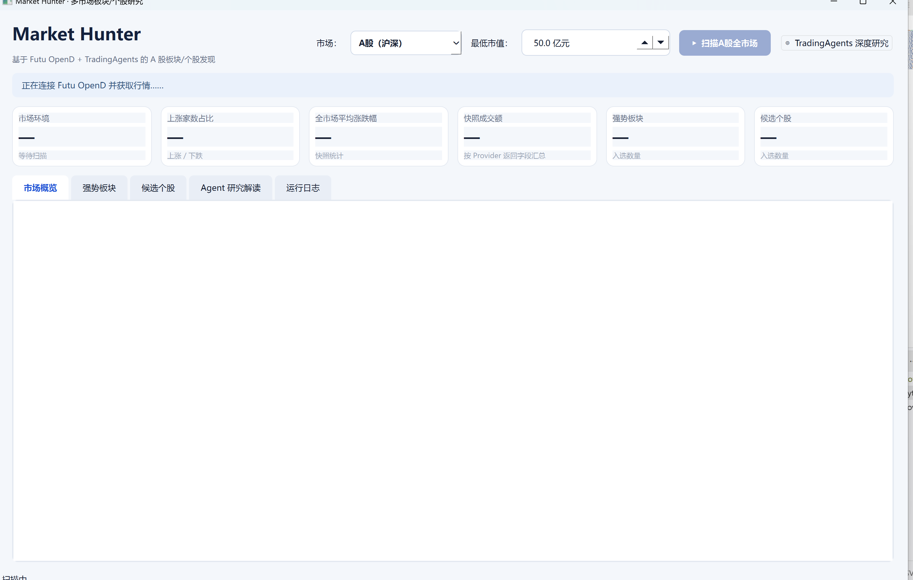
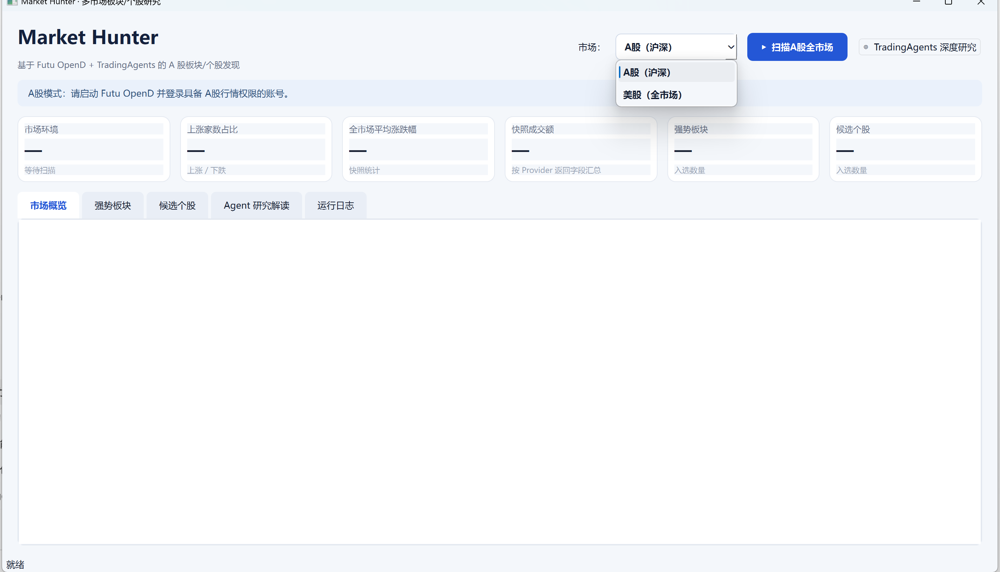
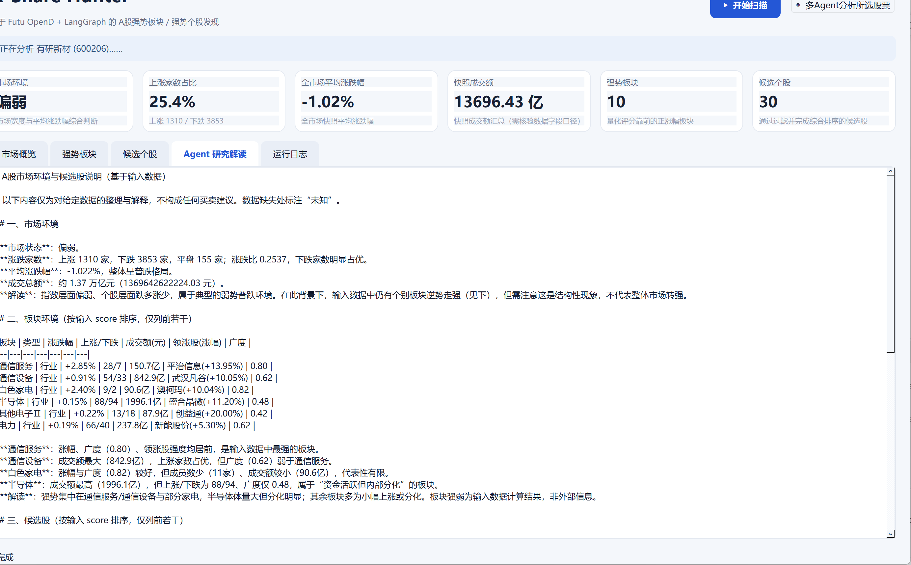
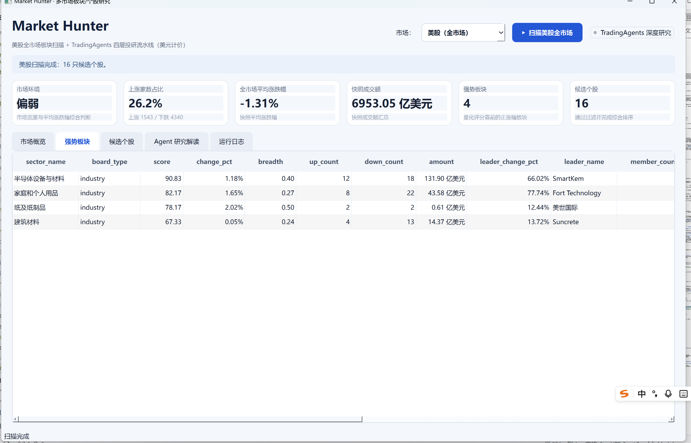
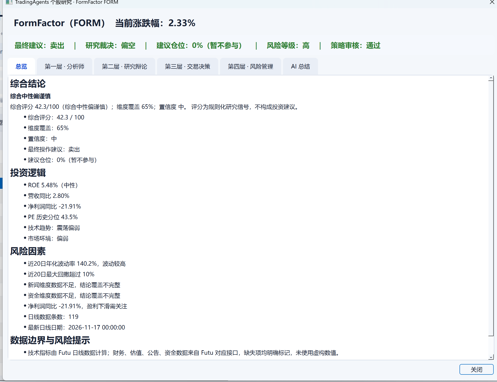
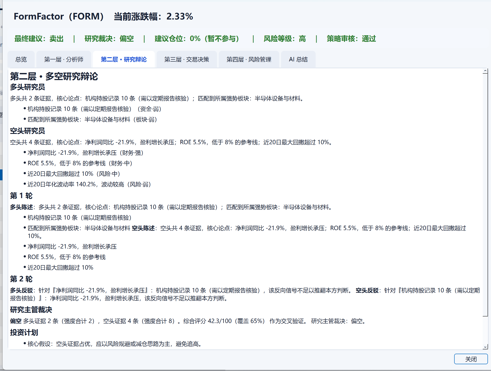

# A-Share Hunter（Futu OpenD 版）

A 股强势板块与强势个股发现 Agent。行情数据通过 **Futu OpenD + futu-api** 获取，Pandas 负责量化打分，LangGraph 编排工作流；DeepSeek 仅用于可选文字解读。

## 一、运行前准备

1. 安装并启动 Futu OpenD。
2. 登录具备 A 股行情权限的 Futu 账号。
3. 确认 OpenD 监听地址和端口，默认 `127.0.0.1:11111`。
4. 安装 Python 依赖并配置环境变量。

```bash
pip install -r requirements.txt
```

Windows：
```powershell
copy .env.example .env
python main.py
```

macOS/Linux：
```bash
cp .env.example .env
python main.py
```

> 只想调试单只股票的 TradingAgents 四层研究、或需要离线复现，见[第十一章 CLI 四层研究调试](#十一cli-四层研究调试mainpy)。

## 二、数据接口映射

| Agent 所需数据 | Futu API |
|---|---|
| A 股静态证券列表 | `get_stock_basicinfo` |
| 全市场行情快照 | `get_market_snapshot` |
| 行业/概念板块列表 | `get_plate_list` |
| 板块成分股 | `get_plate_stock` |
| 个股历史日 K | `request_history_kline` |

官方文档：
- [Futu OpenAPI 介绍](https://openapi.futunn.com/futu-api-doc/intro/intro.html)
- [行情接口总览](https://openapi.futunn.com/futu-api-doc/quote/overview.html)
- [获取市场快照](https://openapi.futunn.com/futu-api-doc/quote/get-market-snapshot.html)
- [获取板块列表](https://openapi.futunn.com/futu-api-doc/quote/get-plate-list.html)
- [获取板块内股票列表](https://openapi.futunn.com/futu-api-doc/quote/get-plate-stock.html)
- [获取历史 K 线](https://openapi.futunn.com/futu-api-doc/quote/request-history-kline.html)

## 三、板块缓存机制

Futu 对板块列表和板块成分股接口有频率限制。本项目将板块成分股缓存到 `output/futu_cache.sqlite3`，默认每次运行最多刷新 10 个板块，缓存 7 天。

首次运行时，部分板块可能尚未进入缓存，因此报告中的板块覆盖率可能不完整。建议在非交易高峰期逐步初始化缓存。若希望一次性刷新所有缺失/过期板块，可在 `.env` 中设置：

```ini
FUTU_MAX_PLATE_REFRESH_PER_RUN=0
```

这可能需要较长时间，不建议在短时间内反复执行。之后可恢复为 10 或更小值。

## 四、数据口径和限制

- 行情快照每批最多 400 个标的；项目自动分批获取。
- 板块强度是根据当前板块成分股的涨跌幅、上涨/下跌家数和成交额聚合计算的，不是 Futu 官方发布的板块指数涨幅。
- 板块成员缓存不是实时更新，默认每 7 天刷新一次。
- 本版本的 `change_pct` 使用 Futu 快照的 `change_rate` 字段；若 SDK 版本字段变化，需检查实际 DataFrame 字段。
- 量比字段在 Futu 快照中未作为必需指标使用；没有可靠值时按缺失处理，不能把缺失值解释为 0 量比。
- 历史 K 线使用前复权（QFQ），MA5/MA20 和近 5 日收益按返回的收盘价计算。
- 行情权限取决于账号认证地区和具体权限。若 OpenD 能连接但接口返回无权限，需先在富途侧确认 A 股行情权限。

## 五、评分流程

行情采集 -> 市场环境 -> 板块强度评分 -> 板块成分股筛选 -> 技术指标补充 -> 可选 LLM 解读 -> Markdown/CSV 报告。

量化评分用于候选排序，不代表收益概率或买卖建议。正式使用前应加入历史回测、交易成本、幸存者偏差、停牌、涨跌停和数据可用性处理。


## 六、Agent 清单与分工

`ashare_hunter/agents/` 共 23 个类，其中 **20 个是 Agent**，按职责分为三组：扫描链路 6 个、单股基础分析 10 个、TradingAgents 四层 4 个。全部采用规则化评分；任一数据源缺失时对应 Agent 标记「数据不足」，不生成虚构数值。输出是研究信号，不构成买卖指令。本章是速查索引，单股分析的详细数据口径见第八章，四层证据与裁决规则见第九章，命令行调试见第十一章。

按统计口径不同会有三个数字：

| 口径 | 数量 | 说明 |
|---|---|---|
| 类名以 `Agent` 结尾 | 20 | 本章列出的全部 Agent |
| 实现 `run()` | 17 | 另 3 个入口是 `TechnicalAgent.enrich()`、`ResearchAgent.explain()`、`ReportAgent.save()` |
| 产出结构化报告 | 14 | 带 `agent` 字段，会出现在深度研究弹窗与 CLI 输出中；扫描链 6 个返回 DataFrame 或文件路径 |

### 6.1 扫描链路（6 个）

由 `graph/workflow.py`（A 股 LangGraph 编排）与 `graph/us_workflow.py`（美股）共用，负责从全市场选出候选股。

| Agent | 入口 | 功能 |
|---|---|---|
| `MarketAgent` | `run()` | 涨跌家数与平均涨幅判定市场「偏强 / 震荡 / 偏弱」，输出涨跌比与成交额合计 |
| `SectorAgent` | `run()` | 板块四维打分（涨幅 35% + 宽度 30% + 领涨股 20% + 成交额 15%），取上涨板块 TopN |
| `StockAgent` | `run()` | 拉取强势板块成分股 → 剔除 ST/退市、非上涨、成交额不足 → 按涨幅/换手/量比/板块分打分取 TopN |
| `TechnicalAgent` | `enrich()` | 给候选股补 MA5、MA20、5 日收益、是否站上均线；单只失败只记 `history_status` 不中断扫描 |
| `ResearchAgent` | `explain()` | 可选 LLM 解读市场、板块与候选股；未启用或调用失败时降级为明确文案，不编造数据 |
| `ReportAgent` | `save()` | 输出 `output/` 下的板块/个股 CSV（UTF-8 BOM）与 Markdown 报告，附风险提示 |

### 6.2 单股基础分析（10 个）

由 `StockAnalysisOrchestrator.analyze()` 统一拉数、逐项容错（`_safe_fetch`）：任一接口失败只让对应 Agent 降级，不影响其他维度；日线失败原因保留在 `data_sources.history`，可在 CLI 与 GUI 中追溯（见第十二章）。趋势、动量、流动性、风险、板块联动 5 个集中在 `stock_analysis.py`。

| Agent | 报告名 | 功能 |
|---|---|---|
| `TrendAgent` | 趋势 Agent | MA5/10/20 判定多头 / 空头 / 震荡排列，输出 MA20 突破与跌破、是否上升趋势（至少 20 根有效收盘） |
| `MomentumAgent` | 动量 Agent | 5/10/20 日收益、RSI(14)、MACD 柱、近 5 根金叉/死叉及日期、量能放大倍数（≥1.2 为放大） |
| `LiquidityAgent` | 流动性 Agent | 成交额、换手率、量比，按 A 股亿元 / 美股亿美元显示；明确成交额不等于资金净流入 |
| `RiskAgent` | 风险 Agent | 当日涨跌幅、近 20 日年化波动率（>50% 提示）、最大回撤（>10% 提示），输出 `risk_flags` |
| `SectorContextAgent` | 板块 Agent | 把个股 `sector_names` 与扫描出的强势板块匹配，给出所属板块涨幅与强度评分 |
| `FinancialAgent` | 财务 Agent | ROE、营收/净利同比、毛利率及多期趋势（连续增长、毛利改善、ROE 变化）；兼容中英文字段别名 |
| `ValuationAgent` | 估值 Agent | PE(TTM)、PB、PS、历史估值分位、PEG（仅 PE>0 且净利增速>0 时计算） |
| `NewsAgent` | 新闻 Agent | 公告/资讯/评级三类检索，按 11 类事件规则标注（新产品、重大订单、行业政策、评级上调等）并过滤无关结果 |
| `CapitalAgent` | 资金 Agent | 主力/超大/大单资金流（当日与累计）、资金分布、机构持股、分析师评级；缺失时按分项回退 |
| `DecisionAgent` | 决策 Agent | 五维加权（财务 25 / 估值 25 / 资金 20 / 新闻 15 / 技术 15）→ 综合分、评级、置信度、覆盖率、投资逻辑与风险清单 |

### 6.3 TradingAgents 四层（4 个）

`TradingAgentsOrchestrator` 先复用 6.2 的 10 份报告，再逐层加工，**不新增数据源**。

| 层 | Agent | 报告名 | 功能 |
|---|---|---|---|
| 第一层补充 | `SentimentAgent` | 情绪面 Agent | 汇总资讯多空条数、主力资金、价格动量、趋势与机构关注度 → 0–100 情绪分；缺失维度从分母剔除 |
| 第二层 | `ResearchDebateAgent` | 研究辩论 Agent | 四层证据矩阵（基本面 / 技术面 / 新闻面 / 宏观面共 15 项）→ 多空论点、两轮辩论、主管裁决、证据覆盖率、尚缺数据与投资计划 |
| 第三层 | `TraderAgent` | 交易 Agent | 买入 / 持有 / 卖出 + 置信度 + 关注区间（由真实均线推导，不给预测目标价）+ 失效条件 |
| 第四层 | `RiskManagementAgent` | 风险管理 Agent | 风险等级与风险分、仓位上限、策略审核（通过 / 调整 / 驳回）、三方风险辩论、前置条件与最终执行决策 |

### 6.4 容易混淆的命名与支撑类

- **两个「板块」**：`SectorAgent` 做全市场板块**排名**；`SectorContextAgent`（报告名「板块 Agent」）做单只股票的**板块归属匹配**。
- **两个「风险」**：`RiskAgent` 计算波动率、回撤等**风险指标**；`RiskManagementAgent` 是第四层**审核交易建议并给出仓位**。
- **两个「决策」**：`DecisionAgent` 输出**综合评分**；`TraderAgent` 输出**买卖动作**；最终以第四层 `final_decision` 为准（审核驳回时仓位为 0）。
- **3 个非 Agent 支撑类**：`DebateEvidenceBuilder`（`debate_evidence.py`，构造四层证据检查表）、`StockAnalysisOrchestrator`（基础分析编排 + 数据源容错 + 可选 LLM 总结）、`TradingAgentsOrchestrator`（四层编排）。`fundamental_base.py` 是纯函数工具（数值解析、字段别名、同比、阈值评分、格式化）。

**调用路径**：GUI 扫描按钮 / `main.py scan` 走 6.1 的 6 个 Agent；GUI「深度研究」按钮 / `main.py analyze` / 美股 `USMarketOrchestrator.analyze()` 走 6.2 + 6.3，共 14 份结构化报告。

## 七、Python Qt 可视化界面

安装依赖后启动桌面端：

```bash
python gui.py
```

界面包含：
- 市场概览：市场环境、上涨家数占比、平均涨跌幅、成交额等 KPI；
- 强势板块：展示板块强度评分、涨跌幅、上涨家数占比等；
- 候选个股：展示综合评分、涨跌幅、成交额、换手率、技术指标；
- Agent 研究解读：展示 LLM 或规则生成的文字分析；
- 运行日志：显示扫描状态和错误堆栈。

顶部「深度研究」按钮会随扫描与选股状态切换：待扫描 / 扫描中 / 无候选 / 可研究 / 研究中，按钮上直接显示待研究标的代码，状态栏右侧同步显示「当前标的」。扫描在后台线程执行，界面不会因行情请求而冻结。启动前仍需运行 Futu OpenD 并登录有相应行情权限的账号。


## 八、候选股单股多 Agent 深度分析

扫描完成后，在「候选个股」表格中选中一只股票（或双击该行），点击顶部「深度研究」按钮，也可按 Ctrl+Enter。按钮会显示当前标的代码；未选中任何行时直接点击会默认分析第一只候选股。研究期间按钮变紫色并显示已用秒数，市场下拉框与扫描按钮暂时锁定，避免并发请求与结果错位；完成后结果弹窗置前展示。程序会在后台线程拉取该股票数据，并运行以下 Agent：

**技术面 Agent（已有）**
- 趋势 Agent：MA5 / MA10 / MA20 均线结构；
- 动量 Agent：5/10/20 日收益、RSI(14)、MACD 柱；
- 流动性 Agent：成交额、换手率字段、量比；
- 风险 Agent：近20日年化波动率、最大回撤及简单风险提示；
- 板块 Agent：匹配扫描结果中的所属强势板块。

**基本面类 Agent（本次新增）**
- 财务 Agent：ROE、营业总收入同比、归母净利润同比、销售毛利率，取自 Futu 财报接口的关键指标表与利润表；
- 估值 Agent：PE(TTM)、PB、PS、PE/PB 历史估值分位（Futu 估值详情接口）、PEG（PE-TTM ÷ 净利润同比，增速≤0 时不计算）；
- 新闻 Agent：Futu 公告/资讯/评级检索，按标题关键词标注业绩预告、重大合同、并购重组、增减持、风险事项等事件类型，并过滤与个股无关的结果；
- 资金 Agent：主力/超大/大/中/小单净流入、特大+大单成交结构、机构持股记录数、分析师评级记录数；
- 决策 Agent：按可配置权重汇总五个维度形成综合评分、投资逻辑与风险因素，并披露维度覆盖率与置信度。

**数据口径与边界**
- 所有财务、估值、公告、资金数据均来自 Futu OpenD 真实接口；接口未返回或字段无法核验时，对应 Agent 标记"数据不足"，不生成虚构数值。
- 财务指标以财报口径为准；毛利率阈值未做行业区分；PEG 仅在净利润同比为正时计算。
- 历史估值分位为 Futu 计算的真实分位数据（默认近 5 年，可用 `VALUATION_INTERVAL` 调整）。
- 新闻 Agent 仅对标题做关键词事件标记，消息真伪与完整性须以交易所公告原文核实。
- 机构持股、评级记录为可核验的记录条数；评级观点不等同于机构持仓；成交额、换手率、量比不等于主力净流入。
- 综合评分是规则化研究信号，维度覆盖不足时置信度自动降低；LLM 总结仅在 `.env` 配置 `LLM_ENABLED=true` 和 API Key 后启用，且只总结已提供的结构化结果。
- 本分析仅供研究参考，不构成投资建议。

### 新增配置项

在 `.env` 中可按需调整（完整示例见 `.env.example`）：

```ini
FINANCIAL_REPORT_COUNT=5       # 获取几期财报
VALUATION_INTERVAL=YEAR_5      # 估值分位区间：YEAR_3/YEAR_5/YEAR_10 等
NEWS_MAX_COUNT=20              # 各类资讯最多返回条数
CAPITAL_FLOW_DAYS=10           # 资金流统计天数
DECISION_WEIGHT_FINANCIAL=0.25 # 决策 Agent 各维度权重（0-1）
DECISION_WEIGHT_VALUATION=0.25
DECISION_WEIGHT_NEWS=0.15
DECISION_WEIGHT_CAPITAL=0.20
DECISION_WEIGHT_TECHNICAL=0.15
```

### 离线验证

无需启动 Futu OpenD 即可验证 Agent 逻辑：

```bash
python -m tests.test_agents
```

## 九、TradingAgents 四层投研决策

单股深度研究在原有分析师团队之上，新增 TradingAgents 式的三层决策流水线。点击"TradingAgents 深度研究"后，程序在后台依次执行：

**第一层 · 分析师团队**
- 复用趋势、动量、流动性、风险、板块、财务、估值、新闻、资金、决策 Agent；
- 新增情绪面 Agent：汇总资讯情绪、主力资金方向、价格动量、分析师关注度四个维度，缺失维度从分母剔除。

**第二层 · 多空研究辩论**
- 多头研究员 / 空头研究员从分析师报告中提取正负证据，按"强 / 中 / 弱"分级；
- 两轮辩论：双方陈述 → 交叉反驳；
- 研究主管综合证据力量与综合评分，裁决"偏多 / 中性 / 偏空"，输出投资计划（核心假设、入场与退出观察条件、时间维度）。

**第三层 · 交易决策**
- Trader Agent 依据辩论裁决与综合评分给出"买入 / 持有 / 卖出"，附置信度、决策依据、由真实均线推导的关注区间与失效条件；
- 维度覆盖不足 40%、证据均势或评分未确认时一律"持有"。

**第四层 · 风险管理**
- 风险检查：波动率、回撤、估值分位、盈利质量、事件风险、数据覆盖、流动性；
- 三方风险观点（激进 / 保守 / 中性）；
- 仓位 = 基准仓位 × 置信度 × 覆盖率 × 风险系数；附条件通过时进一步折减，策略审核驳回时仓位为 0；
- 策略审核检查交易方向与研究裁决的一致性，输出最终执行决策与附加条件。

弹窗顶部横幅直接展示最终操作建议、研究裁决、建议仓位、风险等级与审核结果；下方标签页分别展示总览、分析师、研究辩论、交易决策、风险管理与 AI 总结。

### 9.1 多空辩论的四层证据检查表

第二层辩论把「基本面 / 技术面 / 新闻面 / 宏观面」共 **15 个检查问题**转成结构化证据，每条都带判定（是 / 否 / 部分 / 数据不足）、依据数值、数据来源、数据时间、证据出处与归入多头还是空头及强度。GUI「第二层 · 研究辩论」页新增「四层证据检查表」「尚缺数据」「审慎提示」三段，辩论第 1 轮按层列出双方论点，第 2 轮按层交叉反驳。

| 层面 | 检查问题 | 真实数据依据 |
| --- | --- | --- |
| 基本面 | 营收是否持续增长、净利润是否增长、毛利率是否改善、ROE 是否提高 | `get_financials_statements` 多期年报序列：连续增长期数、相邻报告期变动、比率指标百分点差 |
| 技术面 | 是否突破关键均线、MACD 是否金叉、成交量是否放大、是否形成上升趋势 | 前复权日线：MA20 上穿/下穿事件、DIF/DEA 近 5 日穿越、近 5 日均量 / 前 20 日均量、均线多头排列 |
| 新闻面 | 新产品发布、重大订单、行业利好、机构上调评级 | `get_search_news`（NOTICE / NEWS / RATING）标题事件标签，附标题、时间、来源；评级概述仅有条数无方向时不判定 |
| 宏观面 | 利率是否有利于科技股、AI 行业景气度是否提升、市场整体环境是否配合 | 市场 Agent 的 `market_regime` 为真实数据；利率与产业景气度**无自动数据源**，默认「数据不足」 |

宏观层的口径约束（避免编造）：

- 未接入政策利率 / 国债收益率 / 产业订单与资本开支数据，系统**不推断**利率方向或景气度；证据里写明缺少什么、需要补什么。
- 需要纳入时可通过 `TradingAgentsOrchestrator.analyze(stock, market, sectors, macro={...})` 显式录入，**必须自带 `source` 与 `as_of`**，否则仍判数据不足；录入项一律标注「外部录入」、强度为「弱」，界面与日志可追溯。格式示例：

```python
macro = {
    "rate": {"judgement": "有利", "value": "10Y 美债 4.1%", "source": "手动录入", "as_of": "2026-11-18"},
    "industry": {"judgement": "提升", "value": "云厂商资本开支上修", "source": "手动录入", "as_of": "2026-11-18"},
}
```

- 未录入时，科技 / AI 相关板块的**行情涨幅**只作为「间接代理」生成弱证据，文案明确「不等于产业景气度、订单或资本开支数据，也不代表本标的属于该行业」；非科技板块不会替代 AI 景气度。
- 「未检索到新闻」不等于「事件不存在」；「数据不足」项不参与多空计分，全部列入「尚缺数据」清单。
- 多空证据强度相差 3 倍以上、或仅单方有证据时，裁决附「确认偏误 / 缺少对立面校验」审慎提示，建议将结论降级为研究假设。

**说明**：辩论与决策均为规则化、可追溯的推理，论点全部来自真实 Agent 输出，不编造证据；卖出建议对空仓者表示回避。仓位是研究上限而非建仓指令，不构成投资建议。

### 离线验证

```bash
python -m tests.test_trading_agents
python -m tests.test_debate_evidence   # 四层证据、宏观不编造、技术面真实计算、GUI 渲染
```

## 十、多市场研究（市场下拉框切换 A股 / 美股）

主窗口顶部提供「市场」下拉框，在 **A股（沪深）** 与 **美股（全市场）** 之间切换。两个市场**共用同一套界面**：强势板块表格、指标卡、候选个股表格、深度研究按钮与结果弹窗完全一致，不设独立美股 Tab，也没有观察池输入框。

### 使用流程

1. 启动 Futu OpenD 并登录对应市场的行情权限账号（A股或美股，美股需含**板块数据**权限）。
2. 在顶部「市场」下拉框选择目标市场；切换时自动清空上次扫描结果，避免两市场数据混淆。
   - 「最低市值」输入框对**两个市场都可用**，单位随市场切换：A 股为**亿元**（默认 50 亿元，即 `A_MIN_MARKET_CAP_CNY=5000000000`），美股为**亿美元**（默认 10 亿美元，即 `US_MIN_MARKET_CAP_USD=1000000000`）。两个市场各自记忆阈值、互不干扰；可在每次扫描前直接调整，设为 `0` 关闭市值过滤，界面值优先级高于 `.env`。
3. 点击「扫描」：两个市场走**同一条板块扫描链路**——
   全市场快照 → 板块聚合（行业/概念板块成分股当日表现）→ 板块强度排名 → 从强势板块内选股 → 日线补充 MA5/MA20/5 日收益。
   - 美股首次扫描会建立板块成分股缓存（受 `FUTU_MAX_PLATE_REFRESH_PER_RUN` 限流，逐步补齐）；
   - 若账号无美股板块权限，扫描会降级为空板块并给出提示，不中断整体流程。
4. 「强势板块」Tab 查看两个市场的板块强度排名；在「候选个股」表中选中一行（或双击）→ 点击「深度研究」按钮（或 Ctrl+Enter），弹出四层分析结果（分析师 / 研究辩论 / 交易决策 / 风险管理）。扫描完成后会自动选中首只候选股，按钮即时显示其代码。

### 设计说明

- **统一界面 + 下拉切换**：`gui.py` 中 `MarketScanWorker` / `TradingAnalysisWorker` 两个 Worker 通过 `market` 参数分派 A股/美股逻辑；两市场 UI 完全相同。
- **对称的板块扫描**：美股与 A 股共用 `MarketAgent → SectorAgent → StockAgent → TechnicalAgent → ResearchAgent` 链路，仅数据源不同（`get_us_spot` / `get_sectors(market='US')`）。
- **缓存市场隔离**：`plate_members` 表新增 `market` 列区分 A股/美股板块（旧库自动迁移），同名板块互不干扰；快照缓存用 `_spot_market` 标记避免跨市场串用。
- **延迟导入**：LangGraph 工作流在 A股扫描时才导入，即使环境缺少该依赖，GUI 也能正常启动（美股扫描不依赖它）。
- **代码统一**：`FutuProvider._normalise_code` 支持 `AAPL`、`US.AAPL`、`AAPL.US`、`BRK.B` 等形态；`_code6` 对美股返回完整 ticker（含层级）。A 股规则完全不变。
- **复用四层流水线**：`USMarketOrchestrator.analyze()` 直接复用 `TradingAgentsOrchestrator`；财报 Agent 增加英文财报字段别名（Total Revenue / Net Income / Return on Equity / Gross Profit Margin）。
- **美元计价**：成交额按「亿美元」展示；快照字段沿用 `total_amount_yuan` 名称以兼容展示层，实际口径为美元，界面已标注。
- **美股 OTC 容错**：`get_stock_basicinfo(Market.US, STOCK)` 会返回 OTC 粉单（`US_PINK`）等标的，账号通常没有这类行情权限；而 `get_market_snapshot` 是「整批语义」——批内任一代码无权限，整批都会失败（如「暂不提供美股 OTC 市场行情」）。因此扫描前按 `exchange_type` 从源头剔除 OTC/期权/期货等标的；对残留的无权限、退市标的，快照请求在单批失败时**递归二分定位并跳过坏代码**，保留同批其余可用标的，不再让个别标的拖垮整个扫描。状态栏会显示过滤与跳过数量，A 股快照复用同一容错逻辑。
- **双市场市值门槛**：快照字段 `total_market_val`（总市值，`last_price × issued_shares`）统一规整为 `market_cap`，`circular_market_val` 规整为 `float_market_cap`；A 股单位为**人民币元**（界面按亿元展示），美股为**美元**（按亿美元展示）。低于门槛的标的在**快照阶段**即被剔除，并用过滤后的快照覆盖缓存，因此市场概览、板块强度聚合、板块内选股、候选表和深度研究入口都只会看到达标标的；候选表新增「总市值 / 流通市值」两列。深度研究入口另有一道二次防护，拒绝分析低于门槛的标的。
  - 两个市场门槛**完全隔离**：`A_MIN_MARKET_CAP_CNY` + `A_MISSING_MARKET_CAP` 只作用于 `get_spot()`，`US_MIN_MARKET_CAP_USD` + `US_MISSING_MARKET_CAP` 只作用于 `get_us_spot()`；底层 `filter_by_market_cap(..., market='SH'/'US')` 共用同一套规则，统计中带 `market` / `currency` 便于审计。GUI 输入框随市场切换单位并分别记忆各自数值。
  - `equity_valid=False` 的非正股（ETF、优先股等）市值字段为 `N/A` 或 `0`，统一按**缺失**处理而非小市值：默认 `keep` 保留并单独计数提示，设为 `exclude` 则一并剔除；快照完全没有市值字段时默认不误杀，并明确提示「市值门槛未实际生效」。
  - 板块成分股与快照按 `inner` 合并，被过滤标的不会以「行情全空」的行重新进入候选表。A 股 LangGraph 工作流（`build_workflow(min_market_cap_cny=...)`）与美股编排器都支持运行时阈值覆盖；若 Provider 未内置数据层过滤，编排层会兜底执行同一规则并同步快照缓存。
- **缺失数据处理**：任何接口失败或字段缺失都明确标记「数据不足」，不生成虚构数值。

### 配置（`.env`）

A 股扫描筛选（市值门槛默认启用，设为 `0` 可关闭）：

```env
TOP_SECTORS=10
TOP_STOCKS=30
MIN_AMOUNT_YUAN=50000000          # 最低成交额（元）
A_MIN_MARKET_CAP_CNY=5000000000   # 最低总市值（人民币元），默认 50 亿元；0 关闭
A_MISSING_MARKET_CAP=keep         # 无有效市值时：keep 保留并提示 / exclude 一并剔除
```

美股：

```env
US_TOP_SECTORS=10          # 美股强势板块数量
US_TOP_STOCKS=30           # 候选个股数量
US_MIN_AMOUNT_USD=10000000   # 美股最低成交额（美元）
US_MIN_MARKET_CAP_USD=1000000000  # 美股最低总市值（美元），默认 10 亿美元；0 关闭
US_MISSING_MARKET_CAP=keep  # 无有效市值时：keep 保留并提示 / exclude 一并剔除
US_EXCLUDE_OTC=true        # 剔除 OTC 粉单等无行情权限标的（默认 true）
US_SNAPSHOT_BATCH_SIZE=400 # 快照单批代码数，富途上限 400
```

### 常见问题

**扫描美股时报 `get_market_snapshot 调用失败：暂不提供美股 OTC 市场行情`**：见上方「美股 OTC 容错」。默认已自动过滤并隔离这类标的；若仍失败，可把 `US_SNAPSHOT_BATCH_SIZE` 调小（如 100）以缩小单批受影响范围，或确认账号已开通美股基础行情（OTC 行情通常需单独开通）。若源头过滤误伤了个别标的，可设 `US_EXCLUDE_OTC=false`，批次容错仍会自动隔离坏代码。

**提示「市值门槛未实际生效」或候选表市值显示为 `-`**：说明 Futu 快照没有返回 `total_market_val`（常见于行情权限不足、旧版 SDK，或标的 `equity_valid=False`）。可先升级 `futu` SDK 并确认账号对应市场的行情权限；界面「运行日志」的 DEBUG 日志会记录快照返回列名。在字段恢复前，系统**不会**把缺失市值当作小市值剔除，也不会编造数值。A 股与美股的判断逻辑相同，只是货币口径不同。

**扫描后候选个股为 0**：先在「市场概览」查看「过滤前 N 只 → 保留 M 只」，若市值门槛过滤掉了全部标的，把「最低市值」调低或设为 `0`；也可检查成交额门槛（`MIN_AMOUNT_YUAN` / `US_MIN_AMOUNT_USD`）与 `*_MISSING_MARKET_CAP=exclude` 是否叠加过严。

**A 股扫描结果比以前少了**：本版本起 A 股默认启用 **50 亿元**最低总市值门槛，小微盘股会在快照阶段被剔除。如需恢复原来的全市场扫描，把界面「最低市值」设为 `0`，或在 `.env` 设 `A_MIN_MARKET_CAP_CNY=0`。

### 离线验证

```bash
python -m unittest discover -s tests -v  # 全量 309 项（含市值门槛、按钮状态机、Agent 边界、CLI 调试、日线诊断回归）
python -m tests.test_agent_foundation      # 字段工具/报告/LLM 容错/技术面与风险分支
python -m tests.test_agent_decision_edges  # 决策链评分/证据/交易/风控边界与上下文注入
python -m tests.test_main_cli             # CLI 参数/离线三场景/上下文注入/扫描联动（27 项）
python -m tests.test_history_diagnostics  # 日线失败原因可追溯（数据源/容错/结果/CLI/GUI，27 项）
python -m tests.test_gui_analyze_button  # 深度研究按钮：样式/状态/防重复（Qt offscreen）
python -m tests.test_us_market           # 美股板块扫描与数据层测试
python -m tests.test_us_market_cap       # 美股市值门槛专项（字段/策略/缓存/GUI）
python -m tests.test_a_share_market_cap  # A 股市值门槛专项（配置/工作流/双市场隔离）
python -m tests.test_gui_market_switch   # 市场下拉框切换测试（Qt offscreen）
```

> 美股财务/估值/资金等接口的可用字段随 Futu SDK 版本与账号权限变化；缺失维度会在四层研究中标记「数据不足」，不会用 0 或猜测值填充。本功能仅供研究参考，不构成投资建议。

## 十一、CLI 四层研究调试（main.py）

日常修改 Agent 规则、排查证据链时，不用打开 GUI、也不用先做一次全市场扫描：`main.py`
直接调用 `TradingAgentsOrchestrator`，一条命令跑完「第一层分析师 → 第二层多空辩论 →
第三层 Trader → 第四层风险管理」，并打印分层摘要、导出完整结构化结果。

### 三个入口

| 命令 | 用途 | 需要 OpenD |
| --- | --- | --- |
| `python main.py` | 与旧版完全一致：A 股全市场扫描 | 是 |
| `python main.py scan --market US` | 美股全市场板块扫描 | 是 |
| `python main.py scan --analyze SH.600519` | 扫描后带**真实** `market_summary` / `top_sectors` 上下文对指定代码跑四层 | 是 |
| `python main.py analyze --code SH.600519` | 直接对单只股票跑四层（跳过全市场扫描） | 是 |
| `python main.py analyze --code SH.600519 --offline` | 离线确定性样本，用于回归和断点调试 | 否 |

无子命令时按 `scan` 处理，所以 `python main.py --market US` 等价于 `python main.py scan --market US`。完整参数见 `python main.py --help` / `python main.py analyze --help`。

```bash
python main.py analyze --code US.AAPL --market US --offline --fixture bear --detail
python main.py analyze --code SH.600519 --offline --macro-json @output/macro.json
python main.py analyze --code SH.600519 --json-out output/result.json --log-level DEBUG
```

### 关键参数

| 参数 | 说明 |
| --- | --- |
| `--offline` / `--fixture {bull,bear,sparse}` | 使用 `ashare_hunter/data/debug_fixture.py` 的合成样本；不连 OpenD、自动关闭 LLM |
| `--market {A,US}` | `analyze` 与 `scan` 均默认 A 股；分析美股代码时显式指定 `--market US` |
| `--market-json` / `--sectors-json` / `--sector NAME` | 手工注入市场概览与强势板块上下文；`--sector` 可重复 |
| `--macro-json` | 注入利率 / AI 行业景气度；支持内联 JSON、文件路径、`@文件路径` |
| `--detail` | 打印分析师结论、多空论点、四层证据检查表、决策依据与风控检查项 |
| `--json-out PATH` | 导出完整结果；传目录时自动命名；未指定则自动留档到 `output/trading_agents/` |
| `--no-save` / `--no-llm` | 关闭自动留档 / 本次临时关闭 LLM 总结（结束后恢复配置） |
| `--log-level DEBUG` / `--log-file PATH` | 覆盖日志级别与滚动日志文件，详见下一章 |
| `scan --min-cap N` | 最低总市值，单位亿元（A 股）/ 亿美元（美股），`0` 关闭 |

`--fixture` 三场景：`bull` 偏多（裁决偏多、买入）、`bear` 偏空（裁决偏空、卖出）、
`sparse` 所有数据源返回 `available=False`，用来验证「数据不足」不编造证据、不强行裁决的降级路径。

### 输出与退出码

- 控制台按四层分段打印：最终建议（动作 / 裁决 / 仓位 / 风险 / 审核）、分析师评分、
  证据覆盖 `可判定 N/M` 与四层分层覆盖、尚缺数据、Trader 关注区间与失效条件、风控前置条件。
- **日线数据诊断**：日线不可用时打印具体原因（接口异常原文 / 空表 / 缺 `close` 列 / 有效收盘不足 20 根）、
  返回行数与有效收盘根数，以及影响范围（趋势、动量 Agent 与技术面证据将标记「数据不足」）；
  `--detail` 在日线正常时也打印可用状态。诊断同时写入 `data_sources.history`，
  GUI「概览」和「第一层 · 分析师」页会同步显示，排查方向见下一章。
- 完整结果（含 `trading_agents.analysts / research / trading / risk / final_recommendation`、
  原始 `data_sources`、`overall` 等）以 UTF-8 JSON 落盘，便于 diff、复现与脚本消费。
- 退出码：`0` 成功、`2` 参数错误、`1` 运行异常（完整堆栈打印到控制台并写入日志）。

### 宏观上下文不能编造

宏观层没有自动数据源，默认标记「数据不足」。只有显式录入且**带来源与日期**时才生成证据，
并标注「外部录入 / 弱」：

```json
{
  "rate": {"judgement": "有利", "source": "央行公告", "as_of": "2026-11-19"},
  "industry": {"judgement": "提升", "source": "行业协会月报", "as_of": "2026-11-19"}
}
```

判定词可用：有利 / 改善 / 提升 / 上行 / 宽松、不利 / 恶化 / 回落 / 下行 / 收紧、中性 / 持平。
`--market-json` / `--sectors-json` 同理：注入什么就用什么，CLI 不会替你补市场结论。

### 与 GUI 的差异

- CLI 直接指定代码，因此**没有** GUI 那道「低于市值门槛拒绝深度研究」的二次防护；
  `scan --analyze` 从候选表取股票时天然已经过快照阶段过滤。
- `scan --analyze` 会为四层研究另建一次数据连接；GUI 用后台线程，CLI 同步执行。
- `--offline` 样本只用于调试链路，不冒充真实行情；在线模式仍需启动 Futu OpenD 并具备对应行情权限。

### 离线验证

```bash
python -m unittest tests.test_main_cli -v              # CLI 调试入口 27 项（不连 OpenD、不发 LLM 请求）
python -m unittest tests.test_history_diagnostics -v   # 日线诊断 27 项（含数据源失败日志与 GUI/CLI 文案）
```

## 十二、调试日志

程序内置统一日志：**控制台 + 滚动文件 + GUI「运行日志」面板**三路输出。文件记录最全，界面只看关键进展。

### 快速开启

把 `.env` 中 `LOG_LEVEL` 改为 `DEBUG` 后重启程序：

```env
LOG_LEVEL=DEBUG
```

日志默认写入 `output/logs/investmind.log`（单文件 5MB，滚动保留 3 份）。GUI 启动时会在「运行日志」面板提示路径，CLI 结束时也会打印 `调试日志: ...`。

### 能排查什么

- **每次 Futu 接口调用**：方法名、参数摘要、耗时、返回规模；失败时完整保留服务端错误（例如「暂不提供美股 OTC 市场行情 2578256D」）。400 个代码的批次只记录数量与首尾，不会把全表刷进日志。
- **日线不可用的根因**：`request_history_kline` 走独立链路（返回三元组，不经 `_call`），现已单独记录
  `ret` 与服务端错误原文、参数与耗时；返回空表、有效收盘不足 20 根、列名随 SDK 变化时分别打
  WARNING / ERROR（含实际列名）。`_safe_fetch` 降级也带异常类型与消息，失败原因不再被静默吞掉。
  排查顺序：OpenD 连接 → 历史 K 线行情权限 → 标的退市/停牌或次新股 → 接口限频 → SDK 字段变化。
- **快照容错过程**：批次数、二分隔离坏标的、被跳过的无权限代码、OTC 源头过滤按交易所分类统计。
- **板块缓存**：板块列表数量、缓存命中、本次刷新数量与限频、聚合结果规模；旧库 `market` 列迁移也会记录。
- **阶段耗时**：快照 → 市场概览 → 板块聚合/排名 → 板块选股 → 技术面 → 研究解读，以及 TradingAgents 四层每一层的结论与耗时。
- **异常堆栈**：Worker 失败、LangGraph 节点失败、板块降级都会带 `exc_info` 写入文件（界面只显示简洁告警）。

文件日志格式含毫秒、级别、模块:行号与线程名，便于区分 GUI 主线程与扫描 Worker 线程。

### 配置项（`.env`）

```env
LOG_LEVEL=DEBUG                # 写入文件的级别，默认 INFO
LOG_CONSOLE_LEVEL=INFO         # 控制台级别，避免 DEBUG 刷屏
LOG_GUI_LEVEL=INFO             # GUI「运行日志」面板级别
LOG_THIRD_PARTY_LEVEL=WARNING  # futu / langchain / urllib3 等第三方噪音
LOG_FILE=output/logs/investmind.log
LOG_MAX_BYTES=5242880          # 单文件 5MB
LOG_BACKUP_COUNT=3
```

> 日志不会记录 `LLM_API_KEY` 等敏感值；参数摘要只保留方法名、代码数量与首尾代码。GUI 面板限制 2000 行，防止 DEBUG 模式下内存无限增长。
> 实现位于 `ashare_hunter/utils/logging.py`：`setup_logging()`（幂等）、`shutdown_logging()`（释放文件句柄）、`log_duration()` / `log_df()`（阶段耗时与数据规模）；GUI 通过 `_GuiLogBridge` 的 Qt Signal 把 Worker 线程日志安全转发到面板。
> 离线跑测试建议设 `LLM_ENABLED=false`，否则 `ResearchAgent` 会真实请求 LLM 接口、令测试变慢（与日志无关）。

### 离线验证

```bash
python -m unittest tests.test_logging -v   # 日志体系 13 项
```

## 十三、打包为 Windows 可执行程序

项目提供一键打包脚本，基于 PyInstaller 将 PySide6 GUI 打包为 exe。

### 打包方式

在项目根目录执行（脚本会自动安装 PyInstaller）：

```bat
rem 默认：onedir 目录模式（启动快、稳定，推荐）
build.bat

rem 带控制台（打包出错或运行时排查问题用）
build.bat console

rem 单文件模式（只有一个 exe，但启动较慢、体积更大）
build.bat onefile

rem 单文件 + 控制台
build.bat onefile-console
```

PowerShell 用户可用等价脚本：

```powershell
.\build.ps1
.\build.ps1 console
.\build.ps1 onefile
```

### 产物位置

- 默认 onedir 模式：`dist\A-Share-Hunter\A-Share-Hunter.exe`（连同依赖目录一起分发）
- onefile 模式：`dist\A-Share-Hunter.exe`（单个文件）

脚本已自动把 `.env.example` 复制到产物目录。

### 分发与运行

1. 将整个产物目录（onedir）或单个 exe（onefile）复制到目标机器；
2. 把 `.env.example` 复制为 `.env`，按需填写 Futu OpenD 地址、端口及各 Agent 参数；
3. 目标机器需安装并启动 Futu OpenD，登录有 A 股行情权限的账号；
4. 双击 `A-Share-Hunter.exe` 运行。

### 打包说明

- 脚本对 `futu`（含 184 个 protobuf 文件）、`langgraph`、`langchain_core`、`langsmith` 使用 `--collect-all` 整包收集，避免动态导入在打包后丢失；
- `--windowed` 模式下程序不会弹出控制台，如需查看错误日志请用 `console` 模式重新打包；
- 首次打包耗时较长（依赖较多），后续会快一些；
- 打包产物不含 `.env`（含敏感配置），需用户首次运行时自行创建；
- 若杀毒软件误报，属 PyInstaller 常见现象，可添加白名单或从源码运行（`python gui.py`）。

演示截图














